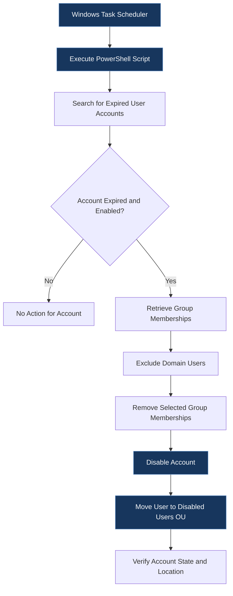
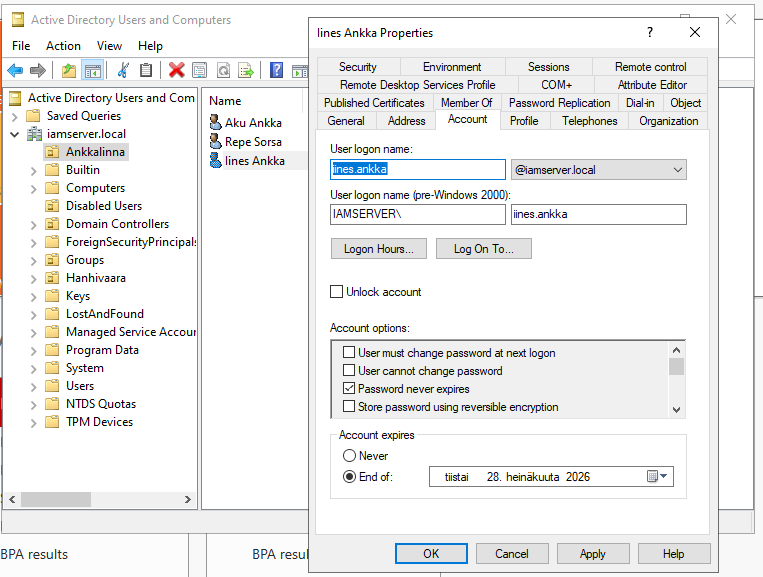
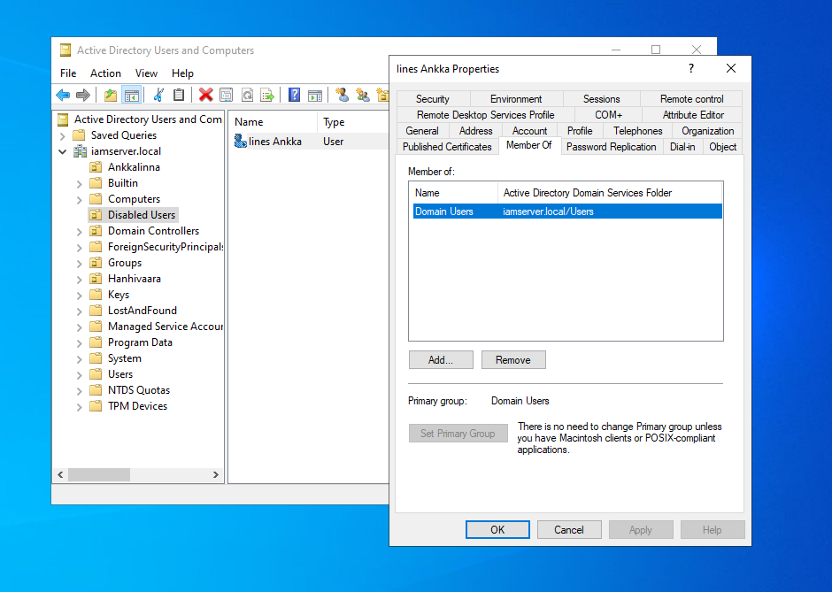
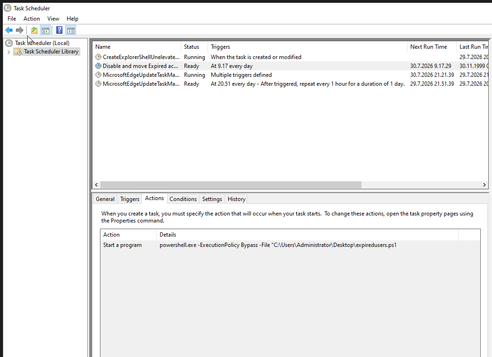
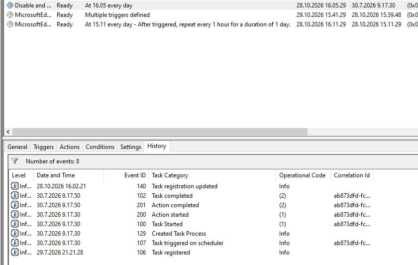

# Active Directory Account Lifecycle Automation

A PowerShell automation project that identifies expired Active Directory user accounts, removes selected group memberships, disables the accounts, and moves them to a designated Organizational Unit (OU). The script is configured to run automatically through Windows Task Scheduler.

This project explores an identity lifecycle management gap relevant to hybrid identity environments and demonstrates a practical, tested approach to automating account-expiration handling.

## Table of Contents

- [Project Overview](#project-overview)
- [Problem Statement and Motivation](#problem-statement-and-motivation)
- [Objectives](#objectives)
- [Technologies Used](#technologies-used)
- [Architecture and Workflow](#architecture-and-workflow)
- [Implementation](#implementation)
- [How to Run](#how-to-run)
- [Testing and Validation](#testing-and-validation)
- [Key Learnings](#key-learnings)
- [Security Considerations](#security-considerations)
- [Limitations and Future Improvements](#limitations-and-future-improvements)
- [References](#references)

## Project Overview

The purpose of this project was to automate the handling of expired user accounts in Active Directory using PowerShell.

The script identifies enabled user accounts whose account-expiration dates have passed. For each matching account, it retrieves group memberships, excludes `Domain Users` from the removal list, removes the selected memberships, disables the account, and moves the user object to a dedicated Disabled Users OU.

After implementing the script, I configured a Windows Scheduled Task to execute it automatically. I then tested the scheduled workflow using a test account with an expiration date set for the following day and verified that the account was automatically disabled after expiration.

## Problem Statement and Motivation

In hybrid identity environments, on-premises Active Directory and Microsoft Entra ID may be connected using Microsoft Entra Connect with Password Hash Synchronization (PHS).

An important distinction is that the on-premises Active Directory account-expiration attribute (`accountExpires`) is not synchronized to Microsoft Entra ID as an account-expiration control. Consequently, an on-premises account can expire while its corresponding cloud identity remains active.

Microsoft documents this behavior and recommends scheduled PowerShell automation to disable expired on-premises accounts.

I chose this project to explore how an automated account lifecycle control could address this gap. Rather than relying solely on an account's expiration date, the workflow takes action on expired accounts by disabling them and performing additional directory cleanup.

The project focuses on the on-premises Active Directory automation component. It does not attempt to implement a complete hybrid identity offboarding or cloud-session revocation solution.

## Objectives

- Identify expired Active Directory user accounts that are still enabled.
- Remove selected group memberships while excluding `Domain Users` from the removal list.
- Disable expired accounts automatically.
- Move the affected user objects to a designated Disabled Users OU.
- Schedule script execution using Windows Task Scheduler.
- Validate the automation using a test account and before-and-after verification.

## Technologies Used

| Technology | Purpose |
|---|---|
| Active Directory Domain Services | User account, group membership, and OU management |
| Windows PowerShell | Automation of account lifecycle operations |
| Active Directory PowerShell module | Querying and managing directory objects |
| Windows Task Scheduler | Automatic execution of the script |
| Windows Server lab environment | Testing and validation |

## Architecture and Workflow

The workflow consists of identifying expired accounts, performing the configured account-management actions, and executing the process on a schedule.



The diagram represents the intended processing flow. The script's implementation and test evidence are described in the sections below.

## Implementation

### 1. Identify expired accounts

The script uses `Search-ADAccount` with the `-AccountExpired` and `-UsersOnly` parameters to locate expired user accounts. A subsequent filter retains accounts whose `Enabled` property is `True`.

### 2. Retrieve group memberships

For each matching account, `Get-ADPrincipalGroupMembership` retrieves its group memberships. The script excludes the group named `Domain Users` from the removal list.

### 3. Remove selected memberships

`Remove-ADPrincipalGroupMembership` removes the retrieved group memberships passed to it. The operation uses `-Confirm:$false` to suppress confirmation prompts and `-Verbose` to display additional command output.

### 4. Disable the account

`Disable-ADAccount` disables the user account.

### 5. Move the account

`Move-ADObject` moves the user object to the configured target OU:

`OU=Disabled Users,DC=iamserver,DC=local`

The destination is specific to my lab environment and would need to be adapted for another Active Directory domain.

### 6. Schedule execution

I configured a Windows Scheduled Task to run the PowerShell script automatically. This allows the account-expiration workflow to execute without requiring me to launch the script manually for each test.

## How to Run

### Requirements
- Windows computer with the Active Directory PowerShell module installed
- Account with sufficient permissions to modify AD users and group memberships
- Access to the target OU

### 1. Configure the target OU

Open PowerShell on a domain-connected machine and navigate to the folder containing the script.

Replace the example OU distinguished name with the appropriate OU in your environment.

```powershell
Import-Module ActiveDirectory

$TargetOU = "OU=Disabled Users,DC=iamserver,DC=local"
```

### 2. Preview the changes

Run the script with `-WhatIf` to preview the actions without making changes:

```powershell
.\Disable-ExpiredADUsers.ps1 -TargetOU $TargetOU -WhatIf
```

Review the output before proceeding.

### 3. Execute the script

After verifying the preview, run:

```powershell
.\Disable-ExpiredADUsers.ps1 -TargetOU $TargetOU
```

The script finds expired, enabled user accounts, removes group memberships except excluded groups, disables the accounts, and moves them to the target OU.

**Caution:** Test in a lab environment first. The script makes changes to Active Directory when run without `-WhatIf`.

## Testing and Validation

I tested the script in my Active Directory lab and documented the results with screenshots.

### Test 1: Identify an expired account

I identified a user account whose expiration date had passed and captured its account status and group memberships before running the script.

**Evidence:** Expired account and existing group memberships.



### Test 2: Execute the script

I ran the PowerShell script directly and verified the resulting changes to the test account.

The screenshots document that the account was disabled, moved to the Disabled Users OU, and had the targeted group memberships removed.

**Evidence:** Account status, OU location, and group membership changes after execution.



### Test 3: Configure scheduled execution

I configured Windows Task Scheduler to execute the script automatically.

**Evidence:** Scheduled Task configuration, including the configured trigger and action.



### Test 4: Verify automated execution

To test the scheduled workflow, I re-enabled the test account and set its account-expiration date for the following day.

After the account expired and the scheduled automation ran, I verified that the account had been disabled again.

This test demonstrated that the workflow could perform the intended account-disabling action through scheduled execution, without requiring me to manually run the script at that time.

**Evidence:** Scheduled execution results and the resulting account state.



*Note: Replace the example screenshot paths above with the actual image filenames in your repository. Only include screenshots that are available and have been sanitized.*

## Key Learnings

Through this project, I gained practical experience with:

- **Active Directory administration:** Querying user accounts and managing account state, group memberships, and organizational unit placement.
- **PowerShell automation:** Combining Active Directory cmdlets, object filtering, and loops to automate a repeatable administrative task.
- **Identity lifecycle management:** Understanding how account-expiration policies relate to the operational process of disabling accounts.
- **Scheduled execution:** Configuring Windows Task Scheduler to run a PowerShell script automatically.
- **Testing and validation:** Using a test account and before-and-after evidence to verify the behavior of the script and its scheduled execution.
- **Hybrid identity security:** Investigating the distinction between on-premises account expiration and the state of a synchronized Microsoft Entra identity.

## Security Considerations

This project was implemented and tested in a lab environment. Before adapting the workflow for production, several considerations would need to be addressed:

- **Permissions:** The scheduled-task identity must have the minimum permissions required to query and modify the relevant accounts, group memberships, and OU objects.
- **Task security:** Protect the scheduled task, its execution identity, and the script file from unauthorized modification or execution.
- **Error handling and logging:** Record actions and failures so administrators can investigate unsuccessful operations.
- **Change validation:** Confirm that an account meets the intended criteria before making destructive or disruptive changes.
- **Group membership impact:** Removing memberships can affect access to resources. The exclusion of `Domain Users` should be validated against the organization's directory configuration and policies.
- **Hybrid identity behavior:** Disabling an on-premises account does not necessarily terminate existing cloud sessions immediately. Additional controls may be needed to revoke sessions and address access in Microsoft Entra ID and connected applications.
- **Synchronization scope:** Validate OU-based synchronization rules and the consequences of moving an account, particularly if the destination OU is excluded from synchronization.

## Limitations and Future Improvements

The current script demonstrates the core workflow, but it could be extended with additional safeguards and operational features.

Potential improvements include:

- Add structured logging and error handling for each account and operation.
- Add a preview mode before applying changes.
- Validate that the target OU exists before processing accounts.
- Handle failures without silently skipping important actions.
- Generate a summary report of accounts processed, actions completed, and errors encountered.
- Review group-membership handling for primary groups and any organization-specific exceptions.
- Evaluate the required synchronization and session-revocation controls for a hybrid identity environment.
- Test additional scenarios, including accounts that are already disabled, missing target OUs, and insufficient permissions.

These are potential future improvements, not claims about features already implemented in the current script.

## References

- [Microsoft Learn: Implement password hash synchronization with Microsoft Entra Connect Sync](https://learn.microsoft.com/entra/identity/hybrid/connect/how-to-connect-password-hash-synchronization) — includes the behavior of account expiration in synchronized environments and guidance on scheduled automation.

## Disclaimer

This project is for educational and demonstration purposes and was tested in a lab environment. It is not a production-ready offboarding solution. Any adaptation for a real organization should undergo appropriate testing, security review, permission scoping, and validation against the organization's identity lifecycle policies.
